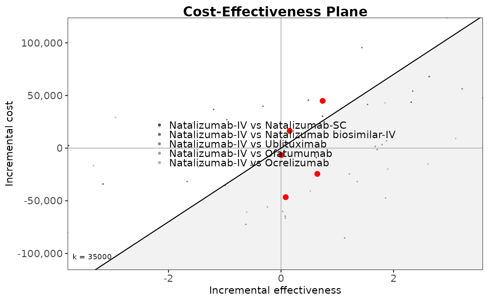

# msdes

## Introduction

This document runs the MS discrete event simulation model. for now a
dummy vignette to test if works or would need to switch to article type.

### Main options

Load the required packages

``` r

library(msdes)
library(WARDEN)
library(MASS)
library(VGAM)
#> Loading required package: stats4
#> Loading required package: splines
library(utils)
library(flexsurv)
#> Loading required package: survival
#> 
#> Attaching package: 'flexsurv'
#> The following objects are masked from 'package:VGAM':
#> 
#>     AICc, dgompertz, pgompertz, qgompertz, rgompertz
library(hesim)
library(purrr)
library(rlang)
#> 
#> Attaching package: 'rlang'
#> The following objects are masked from 'package:purrr':
#> 
#>     flatten, flatten_chr, flatten_dbl, flatten_int, flatten_lgl,
#>     flatten_raw, invoke, splice
library(progressr)
library(data.table)
#> 
#> Attaching package: 'data.table'
#> The following object is masked from 'package:rlang':
#> 
#>     :=
#> The following object is masked from 'package:purrr':
#> 
#>     transpose
#> The following object is masked from 'package:base':
#> 
#>     %notin%
library(BCEA)
#> Registered S3 method overwritten by 'BCEA':
#>   method     from
#>   plot.evppi voi
#> The BCEA version loaded is: 2.4.83 (stable version)
#> A development version is available at https://giabaio.r-universe.dev/BCEA
#> 
#> Attaching package: 'BCEA'
#> The following object is masked from 'package:graphics':
#> 
#>     contour
library(voi)
#> 
#> Attaching package: 'voi'
#> The following object is masked from 'package:BCEA':
#> 
#>     evppi
```

### model setup

Data is loaded in the function gen_inputs(), below is the data contained
within this function

``` r


#summarise_ce_results() # Function to summarise the cost effectiveness results
#summarise_samples() # Function to summarise any data
#run_sim_parallel_new() Function includes input matrix for EVPPI and EVSI

## set a seed 
n_seed<-243523452
set.seed(n_seed)

## number of patients and samples
n_patients <- 10
n_samples <- 10

## Treatments at second line 
v_treatment_names <- c("Natalizumab-IV",
                       "Natalizumab-SC",
                       "Natalizumab biosimilar-IV",
                       "Natalizumab biosimilar-SC",
                       "Cladribine", 
                       "Ublituximab" ,
                       "Ofatumumab",
                       "Ocrelizumab")

## number of treatments
n_treatments <- length(v_treatment_names)

## specify codes for the treatments
v_treatment_codes <- c(seq(1, n_treatments))
names(v_treatment_codes) <- v_treatment_names

## Treatments that patients can move to at 3rd and higher line 
v_higher_line_treatments <- c("Natalizumab-IV",
                              "Natalizumab-SC",
                              "Natalizumab biosimilar-IV",
                              "Natalizumab biosimilar-SC",
                              "Cladribine",
                              "Ublituximab",
                              "Ofatumumab",
                              "Ocrelizumab"
                              )
v_higher_line_treatment_codes <- c(seq(1, length(v_higher_line_treatments)))
names(v_higher_line_treatment_codes) <- v_higher_line_treatments

## prior treatment index
v_prior_treatment_indices <- c(rep(0, length(v_higher_line_treatments)))
names(v_prior_treatment_indices) <- v_higher_line_treatments

## Model event states
v_event_names <- c("initialise","age" , "relapse", "edss_increase", "edss_decrease", "progression", "treatment_switch", "annual_treatment", "serious_adverse_event", "death"
                   )

## Define the possible EDSS values
v_edss_values <- c(0:9)
names(v_edss_values) <- paste("EDSS", v_edss_values)

# Number of EDSS categories
n_edss_values <- length(v_edss_values)
```

### Load Data

Data is loaded in the function gen_inputs(), below is the data contained
within this function

``` r


#load the functions required for the analysis
#devtools::load_all() # load all functions
#Function to generate inputs, the same for both packages
#source("R/generate_inputs.R")
## Model inputs generated using the generate inputs function
# saves the input in a list
# setwd("C:/Users/po22525/University of Bristol/grp-Bristol TAG - MTA-MS - MTA-MS/Working Folder_HE/MS Models/Git Repo/msdes")
#Function to generate inputs, the same for both packages
#source("R/generate_inputs.R")
## Model inputs generated using the generate inputs function
# saves the input in a list
inputs <- gen_inputs(
  # change model settings or assumptions used in scenario analyses
  drc= 0.035, #3.5% discount rate for costs
  drq= 0.035, #3.5% discount rate for qalys
  time_horizon = 70, # number of years model is running for starting at intial age
  p_eid=0.6, # proportion of patients on external interval dosing
  jcvtest_cost= 0 #assumed free due to home service, test cost could be £247 privately but not offered in the NHS
                     )

# Global parameters of the model as they are common to all patients and treatments
indicators <-1
common_all_inputs <- gen_common_all_inputs()

# patient parameters reflecting heterogeneous characteristics that depend on treatment
unique_pt_inputs <- gen_unique_pt_inputs()

# Generate initial events and reaction events
# Add time to event for each patient for each of the treatments
# Setting trt to all treatments should mean that the event applies to all treatments

init_event_list <- gen_init_events(RRMS_events=v_event_names)

evt_react_list <- gen_react_events(RRMS_events=v_event_names)

#util_ongoing_list <- gen_util_ongoing(dmt=v_treatment_names, severity = v_edss_values, RRMS_events=v_event_names)

util_ongoing <- "utilities_disease"
cost_ongoing <- "costs_disease"
util_instant <- c("utilities_relapse", "utilities_sae")
cost_instant <- c("costs_treatment", "costs_relapse", "costs_sae")
```

### Run Model

model is run

``` r


#environment(run_sim_parallel_new) <- asNamespace("WARDEN") 
environment(run_sim_new) <- asNamespace("WARDEN") 


# Run the simulation
#Logic is: per patient, per intervention, per event, react to that event.
total_runtime <- system.time({
  results <- run_sim_new(                                  # use run_sim_parallel() for more than 1 simulation, although I've experienced errors
    npats = n_patients,                               # number of patients to be simulated
    n_sim = n_samples,                                  # number of simulations to run
    psa_bool = TRUE,                         # use PSA or not. If n_sim > 1 and psa_bool = FALSE, then difference in outcomes is due to sampling (number of pats simulated)  
    debug = FALSE,
    sensitivity_bool= FALSE,                  # sensitivity analysis not implemented,
    arm_list = v_treatment_names,             # intervention list
    common_all_inputs = common_all_inputs,    # inputs common that do not change within a simulation
    #common_pt_inputs = common_pt_inputs,     # inputs that change within a simulation but are not affected by the intervention
    unique_pt_inputs = unique_pt_inputs,      # inputs that change within a simulation between interventions
    init_event_list = init_event_list,        # initial event list
    evt_react_list = evt_react_list,          # reaction of events
    util_ongoing_list = util_ongoing,         # ongoing rrms or spms disease utilities
    cost_ongoing_list = cost_ongoing,         # ongoing rrms or spms disease costs
    util_instant_list = util_instant,
    cost_instant_list = cost_instant,         # instantaneous treatment costs
    input_out=c("age", "sex", "spms_flag", "edss_value", "n_relapse", "n_sae_evts", "n_edssinc_evts", "n_edssdec_evts", "current_treatment_code",
                 "treatment_line", "n_switch", "years_on_treatment", "treatment_stop", "t_2ndline", "t_3rdline", "t_4thline", "waning"),
    # v_random_seed_sequence = c(1:n_samples), # Sequence of random seeds
     save_input_matrix = TRUE # Export the input matrix for EVPPI
  )
})
#> Analysis number: 1
#> Simulation number: 1
#> Time to run simulation 1: 0.57s
#> Simulation number: 2
#> Time to run simulation 2: 0.64s
#> Simulation number: 3
#> Time to run simulation 3: 0.55s
#> Simulation number: 4
#> Time to run simulation 4: 0.56s
#> Simulation number: 5
#> Time to run simulation 5: 0.7s
#> Simulation number: 6
#> Time to run simulation 6: 0.84s
#> Simulation number: 7
#> Time to run simulation 7: 0.56s
#> Simulation number: 8
#> Time to run simulation 8: 0.53s
#> Simulation number: 9
#> Time to run simulation 9: 0.56s
#> Simulation number: 10
#> Time to run simulation 10: 0.63s
#> Time to run analysis 1: 6.15s
#> Total time to run: 6.16s
#> Simulation finalized;
```

### Plot Results

``` r

# Summarise the results

dim_results <- c(n_samples, n_treatments, n_patients)
trt_idx <- setNames(seq_along(v_treatment_names), v_treatment_names)
total_costs_ipd <- total_qalys_ipd <-  array(
  NA_real_,
  dim = dim_results,
  dimnames = list(NULL, v_treatment_names, NULL)
)

for (i_sample in seq_len(n_samples)) {
  
  df <- results[[1]][[i_sample]]$merged_df
  
  # Keep only final ("death") rows
  df <- df[df$evtname == "death", ]
  
  idx <- cbind(
    i_sample,
    trt_idx[df$arm],
    df$pat_id
  )
  
  total_costs_ipd[idx]         <- df$total_costs
  total_qalys_ipd[idx]         <- df$total_qalys
}


options(scipen = 999)
total_costs <- apply(total_costs_ipd, c(1, 2), mean)
total_qalys <- apply(total_qalys_ipd, c(1, 2), mean)


#drop natalizumab-biosimilar-SC and cladrebiene
total_costs <- total_costs[,-c(4,5)]
total_qalys <- total_qalys[,-c(4,5)]

results_table <- summarise_ce_results(wtp1 = 25000, wtp2 = 35000,
                                      total_qalys = total_qalys, 
                                      total_costs = total_costs,
                                      reference = "Natalizumab-IV")

knitr::kable(results_table) 
```

|  | Total costs (95% CrI) | Total QALYs (95% CrI) | Net benefit at £25000/QALY (95% CrI) | Net benefit at £35000/QALY (95% CrI) | Incremental costs (95% CrI) | Incremental QALYs (95% CrI) | INB at £25000/QALY (95% CrI) | INB at £35000/QALY (95% CrI) | CEAC at £25000/QALY (95% CrI) | CEAC at £35000/QALY (95% CrI) |
|:---|:---|:---|:---|:---|:---|:---|:---|:---|:---|:---|
| Natalizumab-IV | 350,087.83 (305,986.55, 404,112.50) | 9.47 (7.78, 11.27) | -113,352.24 (-173,052.55, -27,495.65) | -18,658.00 (-92,134.41, 83,900.71) | 0.00 (0.00, 0.00) | 0.00 (0.00, 0.00) | 0.00 (0.00, 0.00) | 0.00 (0.00, 0.00) | 0.2 | 0.3 |
| Natalizumab-SC | 308,420.14 (257,195.67, 347,549.23) | 8.69 (6.09, 10.72) | -91,045.19 (-145,788.57, -15,833.05) | -4,095.21 (-84,902.41, 87,959.10) | -41,667.70 (-109,838.51, 22,753.11) | -0.77 (-3.11, 1.56) | 22,307.05 (-18,981.04, 62,584.38) | 14,562.79 (-48,830.31, 73,813.71) | 0.3 | 0.2 |
| Natalizumab biosimilar-IV | 333,512.62 (298,599.82, 363,665.80) | 9.32 (5.15, 12.96) | -100,520.23 (-201,924.20, -24,329.92) | -7,323.27 (-150,443.50, 103,427.12) | -16,575.22 (-63,264.88, 30,022.62) | -0.15 (-3.36, 3.62) | 12,832.01 (-37,223.92, 84,997.27) | 11,334.73 (-67,587.23, 121,244.23) | 0.2 | 0.2 |
| Ublituximab | 356,696.85 (318,927.43, 380,577.63) | 9.46 (6.34, 12.79) | -120,149.71 (-198,893.85, -57,033.82) | -25,530.86 (-135,458.98, 67,935.66) | 6,609.02 (-39,749.02, 56,197.10) | -0.0075 (-2.99, 3.22) | -6,797.48 (-77,624.13, 93,886.67) | -6,872.86 (-104,726.45, 124,047.56) | 0.3 | 0.3 |
| Ofatumumab | 374,415.43 (332,270.68, 421,737.65) | 8.82 (7.17, 10.21) | -153,874.53 (-229,529.64, -81,441.11) | -65,658.18 (-155,130.72, 19,517.41) | 24,327.59 (-37,163.68, 63,718.05) | -0.65 (-1.87, 0.45) | -40,522.30 (-87,138.63, 22,074.28) | -47,000.18 (-103,734.82, 16,743.38) | 0 | 0 |
| Ocrelizumab | 399,164.83 (340,270.16, 442,365.77) | 9.38 (6.75, 12.81) | -164,753.03 (-218,884.78, -102,187.02) | -70,988.31 (-146,904.62, 20,730.03) | 49,076.99 (-3,189.51, 108,555.98) | -0.093 (-1.78, 3.14) | -51,400.79 (-115,904.19, 8,933.74) | -52,330.31 (-123,337.63, 38,547.14) | 0 | 0 |

``` r

#write.csv(results_table, paste0(c("results/results warden determenistic", n_samples, "x", n_patients, ".csv"), collapse = " "))

#plot results
v_results_treatment_names<- v_treatment_names[-c(4,5)]

# Create a BCEA object
des_bcea <- bcea(eff = total_qalys,
                 cost = total_costs,
                 ref = 1,
                 interventions = v_results_treatment_names)
ceplane.plot(des_bcea, wtp = 35000,
             graph = "ggplot2")
```



``` r


#plot a CEAC
des_multi_ce <- multi.ce(des_bcea)
ceac.plot(des_multi_ce, graph = "ggplot2",
          line = list(color = c("darkorange", "palegreen3", "blue", "grey",
                                "cyan3", "black"),
                      size=2 ),
          #ylim=c(0, 0.5),
          pos = c(1, 1)
)
```


``` r


#compare key events by treatment groups
modelresults_summarised <- summary_results_sim(results[[1]])
proportion_spms  <- modelresults_summarised["spms_flag",]
average_numberof_relapses <- modelresults_summarised["n_relapse",] 
average_numberof_edssincreases <- modelresults_summarised["n_edssinc_evts",] 
average_numberof_edssdecreases<- modelresults_summarised["n_edssdec_evts",] 
average_numberof_saes<- modelresults_summarised["n_sae_evts",] 
final_edss_value <- modelresults_summarised["edss_value",]
average_numberof_treatmentswitches <- modelresults_summarised["n_switch",] 
average_numberof_yearsontreatment <- modelresults_summarised["years_on_treatment",] 
average_numberof_yearson2ndline<- modelresults_summarised["t_2ndline",] 
average_numberof_yearson3rdline<- modelresults_summarised["t_3rdline",] 
average_numberof_yearson4thline<- modelresults_summarised["t_4thline",]

key_events_trt_grps <- as.data.frame(rbind(
  proportion_spms,   average_numberof_relapses, 
  average_numberof_edssincreases,   average_numberof_edssdecreases, 
  final_edss_value,   average_numberof_saes,
  average_numberof_treatmentswitches,  average_numberof_yearsontreatment,
  average_numberof_yearson2ndline,  average_numberof_yearson3rdline,
  average_numberof_yearson4thline),
  row.names=c("proportion with spms", "average no. of relapses", 
              "average no. of edss increases", "average no. of edss decreases", 
              "final edss value", "average no. of SAEs",
              "average no. of treatment switches", "average no. of years on treatment",
              "average no. of years on 2ndline", "average no. of years on 3rdline",
              "average no. of years on 4thline")
)
knitr::kable(key_events_trt_grps)
```

|  | Natalizumab-IV | Natalizumab-SC | Natalizumab biosimilar-IV | Natalizumab biosimilar-SC | Cladribine | Ublituximab | Ofatumumab | Ocrelizumab |
|:---|:---|:---|:---|:---|:---|:---|:---|:---|
| proportion with spms | 0.29 (0.1; 0.5) | 0.33 (0.1; 0.6) | 0.34 (0.1; 0.8) | 0.25 (0; 0.6) | 0.35 (0.2; 0.7) | 0.34 (0.1; 0.5) | 0.35 (0.2; 0.5) | 0.27 (0; 0.5) |
| average no. of relapses | 2.45 (1; 4.3) | 2.13 (1.2; 3.7) | 2.47 (0.8; 4.1) | 2.21 (0.9; 3.2) | 2.46 (1.3; 3.6) | 2.21 (0.7; 3.3) | 2.47 (1; 4.2) | 2.55 (1.3; 5) |
| average no. of edss increases | 2.63 (1.4; 4) | 2.33 (1; 4.1) | 2.22 (1.1; 3.6) | 2.55 (1.2; 4.5) | 2.97 (1.2; 6.3) | 2.68 (1.1; 3.7) | 2.36 (0.9; 4) | 2.36 (1.4; 3.8) |
| average no. of edss decreases | 1.71 (1.4; 2.2) | 1.59 (1.2; 2) | 1.5 (1; 1.9) | 1.65 (1.4; 2) | 1.62 (1; 2.8) | 1.6 (1.1; 2.2) | 1.54 (1; 2.2) | 1.65 (1; 2.2) |
| final edss value | 4.65 (3; 5.7) | 4.63 (3.2; 6.2) | 4.65 (3.6; 6.2) | 4.67 (2.8; 5.9) | 5.16 (4; 6.7) | 4.74 (2.9; 5.9) | 4.74 (3.9; 5.9) | 4.62 (3.1; 6) |
| average no. of SAEs | 3.99 (2.2; 7) | 3.65 (2.8; 7) | 4.58 (2.6; 6.5) | 4.07 (3.2; 5.9) | 4.04 (2.7; 6.4) | 3.99 (2.5; 7.3) | 7.39 (3.4; 20.7) | 4.4 (2.4; 6.6) |
| average no. of treatment switches | 1.09 (0.3; 1.9) | 1.19 (0.7; 1.8) | 1.11 (0.6; 1.9) | 1.17 (0.6; 1.8) | 1.13 (0.6; 1.7) | 1.12 (0.4; 1.7) | 1.24 (0.5; 2.2) | 1.11 (0.6; 1.9) |
| average no. of years on treatment | 20.57 (14.7; 32.6) | 18.08 (8.3; 23.8) | 20.56 (11.8; 35.2) | 19.15 (12.2; 30.7) | 14.85 (3.3; 23.3) | 17.96 (9.9; 24.6) | 19.47 (9.7; 22.6) | 17.88 (11.2; 24.3) |
| average no. of years on 2ndline | 19.34 (11.2; 32.2) | 16.39 (9.9; 24.5) | 17.54 (6.4; 32.4) | 18.67 (13.1; 28.1) | 14.5 (7.7; 19.4) | 17.28 (7.5; 26.7) | 15.51 (10.1; 21.2) | 17.97 (9; 28) |
| average no. of years on 3rdline | 6.89 (1.4; 12.1) | 5.47 (2.1; 9.7) | 5.78 (2; 14.2) | 6.21 (0.6; 14.2) | 5.28 (1.6; 13.7) | 6.42 (2.8; 14.6) | 6.1 (2.3; 15.7) | 6.67 (2.8; 11.4) |
| average no. of years on 4thline | 4.64 (0.9; 12) | 5.16 (0; 15.6) | 3.91 (0; 9.6) | 4.71 (1.8; 7.7) | 3.52 (0; 7.2) | 4.16 (0; 6.7) | 5.1 (0; 12) | 4.26 (0.2; 6.9) |

``` r


#  VOI analysis
#total EVPI

total_evpi <- voi::evpi(outputs = list(c = total_costs,
                                       e = total_qalys,
                                       k = c(0, 25000, 50000, 75000, 100000)))

knitr::kable(total_evpi)
```

|      k |       evpi |
|-------:|-----------:|
|      0 |   6609.939 |
|  25000 |  20786.200 |
|  50000 |  73549.324 |
|  75000 | 117721.152 |
| 100000 | 161978.456 |

``` r

plot(x=total_evpi$k, y=total_evpi$evpi, type="l")
```


``` r


# Total EVPPI
# All  parameters excluding hazard ratios that are constant as it causes errors
# df_inputs <- as.data.frame(results[["input_matrix"]][,-c(73:76,81:84,89:92,79:101)])
# parameters <- as.list(colnames(df_inputs))
# 
# total_evppi <- voi::evppi(outputs = list(c = total_costs,
#                                          e = total_qalys,
#                                          k = c(25000, 35000)),
#                           inputs = df_inputs,
#                           pars = parameters,
#                           method = "bart", 
#                           verbose = TRUE)
# 
# knitr::kable(total_evppi)
# 
# #plot in base R split ober A and B panels as there are too many parameters to plot
# total_evppi_25k_a <- total_evppi$evppi[total_evppi$k ==25000 & total_evppi$evppi > mean(total_evppi$evppi)]
# names(total_evppi_25k_a) <- total_evppi$pars[total_evppi$k ==25000 & total_evppi$evppi > mean(total_evppi$evppi)]
# par(las=1, bg="white", mai=c(0.85, 4, 0.5, 0.5))
# barplot(
#   sort(total_evppi_25k_a, decreasing=FALSE), horiz = TRUE, cex.names=0.9, main="EVPPI WTP 25,000/QALY (A)", xlab= "£"
# )
# 
# total_evppi_25k_b <- total_evppi$evppi[total_evppi$k ==25000 & total_evppi$evppi < mean(total_evppi$evppi)]
# names(total_evppi_25k_b) <- total_evppi$pars[total_evppi$k ==25000 & total_evppi$evppi < mean(total_evppi$evppi)]
# barplot(
#   sort(total_evppi_25k_b, decreasing=FALSE), horiz = TRUE, cex.names=0.6, main="EVPPI WTP 25,000/QALY (B)", xlab= "£"
# )
# 
# total_evppi_35k_a <- total_evppi$evppi[total_evppi$k ==35000 & total_evppi$evppi > mean(total_evppi$evppi)]
# names(total_evppi_35k_a) <- total_evppi$pars[total_evppi$k ==35000 & total_evppi$evppi > mean(total_evppi$evppi)]
# par(las=1, bg="white", mai=c(0.85, 4, 1, 0.5))
# barplot(
#   sort(total_evppi_35k_a, decreasing=FALSE), horiz = TRUE, cex.names=0.5, main="EVPPI WTP 35,000/QALY (A)", xlab= "£"
# )
# 
# total_evppi_35k_b <- total_evppi$evppi[total_evppi$k ==35000 & total_evppi$evppi < mean(total_evppi$evppi)]
# names(total_evppi_35k_b) <- total_evppi$pars[total_evppi$k ==35000 & total_evppi$evppi < mean(total_evppi$evppi)]
# par(las=1, bg="white", mai=c(0.85, 4, 1, 0.5))
# barplot(
#   sort(total_evppi_35k_b, decreasing=FALSE), horiz = TRUE, cex.names=0.6, main="EVPPI WTP 35,000/QALY (B)",xlab= "£"
# )
```
